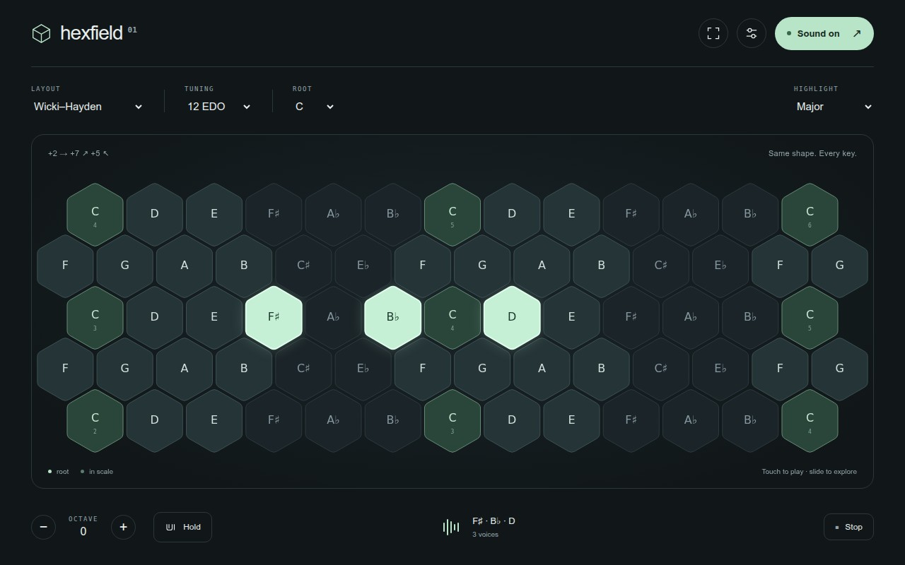

# hexfield

**Music has more than one shape.**

A hexagonal, microtonal instrument that runs entirely in the browser. One HTML
page, a canvas, and a few ES modules. No build step, no dependencies, no network
requests after load.

**Play it at <https://thinks.lol/hexfield/>.**



The same key shape gives you the same intervals in every tuning: the keyboard
is a lattice, not a piano. Sliding across the grid moves by whole tones, the
diagonals move by fourths and fifths, and the octave is wherever the arithmetic
puts it.

## What it does

- **Four layouts** on the same hexagonal lattice: Wicki–Hayden, Sonome
  (harmonic table), Chromatic, and Custom (set the interval of each axis
  yourself, in steps of the current tuning).
- **Six equal temperaments**: 12, 19, 22, 24, 31 and 53 EDO.
- **Three outputs**, chosen from the Connect dialog:
  - **Sound** — a self-contained polyphonic Web Audio synth. Plays every tuning.
  - **USB MIDI** — Web MIDI output to hardware, with an optional MPE mode for
    tunings other than 12 EDO.
  - **Audio MIDI (lab)** — an experimental encoder that writes MIDI bytes as a
    31,250-baud UART waveform onto a stereo audio output. Read the
    [caveats](#the-audio-midi-experiment) before using it.
- **Touch-first playing**: multi-touch, glissando by dragging between keys,
  Hold to latch notes, optional haptic taps, landscape layouts for phones.
- **Computer keyboard**: `A`–`K` and `Q`–`I` play two rows, `Z`/`X` shift
  octaves, `Space` toggles Hold, `Escape` releases everything.
- **Preferences persist** in `localStorage` under `hexfield-v1`.
- **Installable**: web app manifest and icon, so it can be added to a home
  screen and run without browser chrome.

## Running it

ES modules and AudioWorklet both require a real HTTP origin, so `file://` will
not work.

```sh
npm start           # python3 -m http.server 8080
# then open http://localhost:8080
```

Any static server works. There is nothing to install and nothing to compile.

## Tests

```sh
npm test            # node --test test/*.test.mjs
```

32 tests, no dependencies. They cover the tuning and geometry maths in
`test/music.test.mjs` and the UART encoder in `test/serial.test.mjs`. The
encoder tests are a genuine round trip: they generate the waveform, decode it
back with an independent 8N1 receiver, and compare against the bytes that went
in.

## Files

| File | Role |
| --- | --- |
| `index.html` | All markup: control strip, canvas, performance bar, and the two `<dialog>` sheets. |
| `style.css` | The whole visual design. No frameworks, no web fonts. |
| `app.js` | UI, state, canvas rendering, pointer and keyboard input. |
| `music.js` | Pure music maths: layouts, tunings, note names, scales, MIDI pitch/bend, hex geometry. |
| `engine.js` | Output routing: Web Audio synth, Web MIDI + MPE, and the lab encoder. |
| `serial.js` | The UART waveform encoder. Pure functions, no audio dependencies, easy to test. |
| `midi-worklet.js` | AudioWorklet wrapper around `serial.js` so bytes are emitted sample-accurately. |
| `icon.svg`, `manifest.webmanifest` | Installable web app metadata. |
| `test/` | Node test suite for `music.js` and `serial.js`. |

## How it works

### The lattice

Keys live on a hex grid in axial coordinates `(q, r)`.

```js
stepAt(q, r, state) = a*q + b*r + octave*edo
```

`a` and `b` are the interval, in tuning steps, of moving one cell across and one
cell up-right. Each layout declares them relative to 12 EDO and they are rescaled
to the current tuning by rounding to the nearest whole step:

| Layout | Across | Up-right | Character |
| --- | --- | --- | --- |
| Wicki–Hayden | +2 | +7 | Whole tones across, fourths and fifths on the diagonals |
| Sonome | +4 | +7 | Harmonic table; thirds and fifths form triangles |
| Chromatic | +1 | +5 | Semitones across, fourths rising |
| Custom | *n* | *m* | Whatever you set |

Because a step is a step, "one cell across" is always two twelfths of an octave
— 2 steps in 12 EDO, 3 in 19, 5 in 31 — rounded to whatever the tuning can
actually express. That is the whole point of the instrument: the shape is the
constant, the grid is the variable.

### Tuning

```js
pitchForStep(step) = 60 + root + step*12/edo
frequency(pitch)   = 440 * 2**((pitch - 69)/12)
```

A *step* is always `12/edo` semitones, so pitch stays in the familiar semitone
space even when the tuning is not. 53 EDO steps are about 22.6 cents each.

### Audio

Each voice is an oscillator → lowpass → gain, summed into a master gain and a
`DynamicsCompressor`. The envelope is 9 ms attack, exponential decay to 65 % over
200 ms, and a 45 ms release. Three timbres: soft triangle, pure sine, bright saw
(with a 4.5 kHz corner instead of 2.4 kHz).

### MIDI and MPE

Standard MIDI cannot express notes between semitones, so 12 EDO goes out as
ordinary note messages and everything else needs pitch bend. With MPE enabled
the app configures a lower zone — channel 1 as manager, channels 2–16 as members
— declares a 48-semitone bend range via RPN 0 on every member channel, and
allocates a member channel per note. Pitches are split into a nearest integer
note plus a 14-bit bend:

```js
bend = 8192 + (pitch - note) / bendRange * 8192
```

Only the internal synth and an MPE-enabled destination can play the non-12-EDO
tunings in this version.

### The Audio MIDI experiment

`serial.js` turns MIDI bytes into a UART line: 31,250 baud, 8 data bits, no
parity, one stop bit, least significant bit first. Each bit lasts exactly
`sampleRate / 31250` samples — 3.072 at 96 kHz — and the encoder carries the
fractional remainder forward, so bit boundaries land on whole samples without
drifting. The line is rendered as a stereo differential:

| Mode | Current-on bit |
| --- | --- |
| Type A (nominal) | right positive, left negative |
| Type B | reversed |

Silence is exactly zero on both channels between messages.

**What this is not.** These are normalised audio samples, not MIDI voltages or
currents. A headphone DAC is not a MIDI output: AC coupling, level, filtering
and resampling will all interfere, and choosing a polarity cannot turn a DAC
into an interface. The waveform has been verified digitally — the tests decode
all 256 byte values back out and confirm the bit timing — but **the physical
connection has not been tested**. Use a proper level-conversion/interface
circuit, or use USB MIDI for standard hardware. Keep speakers and headphones
disconnected when arming this mode.

## What has been verified

- **Tuning maths** — layouts, EDO rescaling, octave closure, scale membership,
  pitch bend limits, and hex-grid round trips, in `test/music.test.mjs`.
- **Encoder** — all 256 byte values and several complete MIDI messages round-trip
  through an independent decoder; edge spacing is 3 or 4 samples with an exact
  3.072 average; Type A/B polarity and silence are asserted, in
  `test/serial.test.mjs`.
- **In a browser** — loads with no console errors, renders the hex grid, connects
  the synth, plays polyphonically (a three-voice chord reads back as
  `F♯ · B♭ · D`), switches to 19 EDO and re-labels both axes (`+3 → +11 ↗ +8 ↖`),
  and persists preferences.

**Not verified:** the physical audio-MIDI path, real hardware over Web MIDI, and
behaviour on Safari and Firefox beyond the internal synth.

## Browser support

Best in Chrome/Chromium, which has Web MIDI (including on Android), AudioWorklet
and `setSinkId` for choosing an audio output. Elsewhere the internal synth still
works; MIDI and the lab encoder degrade with a clear message rather than failing
silently.

## Privacy

No analytics, no accounts, no recordings, and no requests to a server. Settings
live in `localStorage` and nowhere else.

## Provenance

Recovered from the deployed static assets at
`https://hexfield-garrison.transparentcorgi2.chatgpt.site` on 2026-11-13. The
original source tree was not available, so these files are the deployed sources
verbatim, with one change: the Cloudflare challenge script that the edge injects
into `index.html` was removed so the page is self-contained.

## Hosting

Live at **<https://thinks.lol/hexfield/>**, published from the
[thinks.lol](https://github.com/thinks-lol/thinks.lol) Hugo site. That site
carries this repository as a submodule and copies the nine runtime files into
its build output at `/hexfield/`; tests, docs and repo metadata are not
published. Updating the live instrument is a submodule bump in that repo.

It is a static site with no build step, so anywhere that serves files over HTTPS
works — GitHub Pages, Cloudflare Pages, Netlify, or a plain bucket. Three
requirements:

- **Serve it at a domain root or a subpath.** Every URL in `index.html` is
  relative (`./app.js`, `./icon.svg`, `./midi-worklet.js`), so both
  `https://example.com/` and `https://example.com/hexfield/` work. Both layouts
  have been tested.
- **Correct MIME types** for `.js` (`text/javascript`) and `.webmanifest`
  (`application/manifest+json`). GitHub Pages and Cloudflare Pages do this
  already.
- **HTTPS**, because Web MIDI, AudioWorklet, `setSinkId` and device selection all
  require a secure context. Plain HTTP still loads the internal synth.

## Licence

Not yet chosen.
